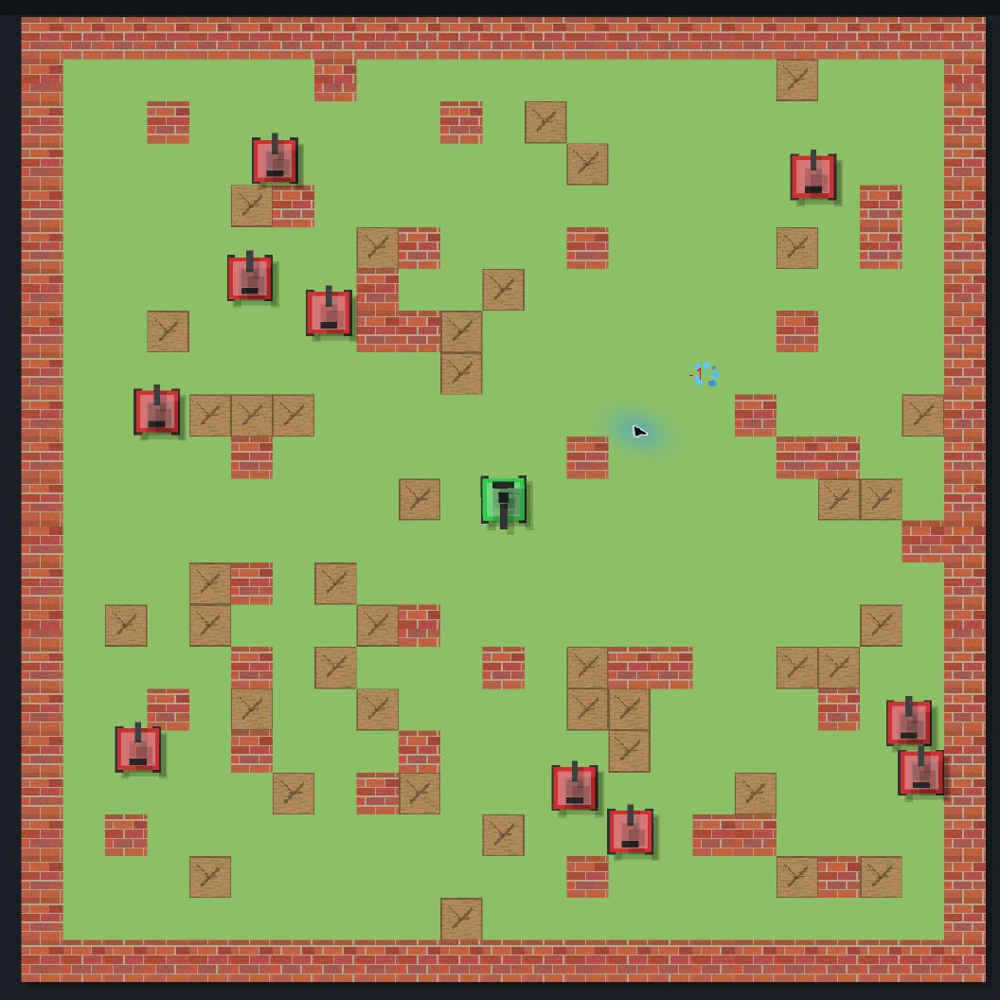
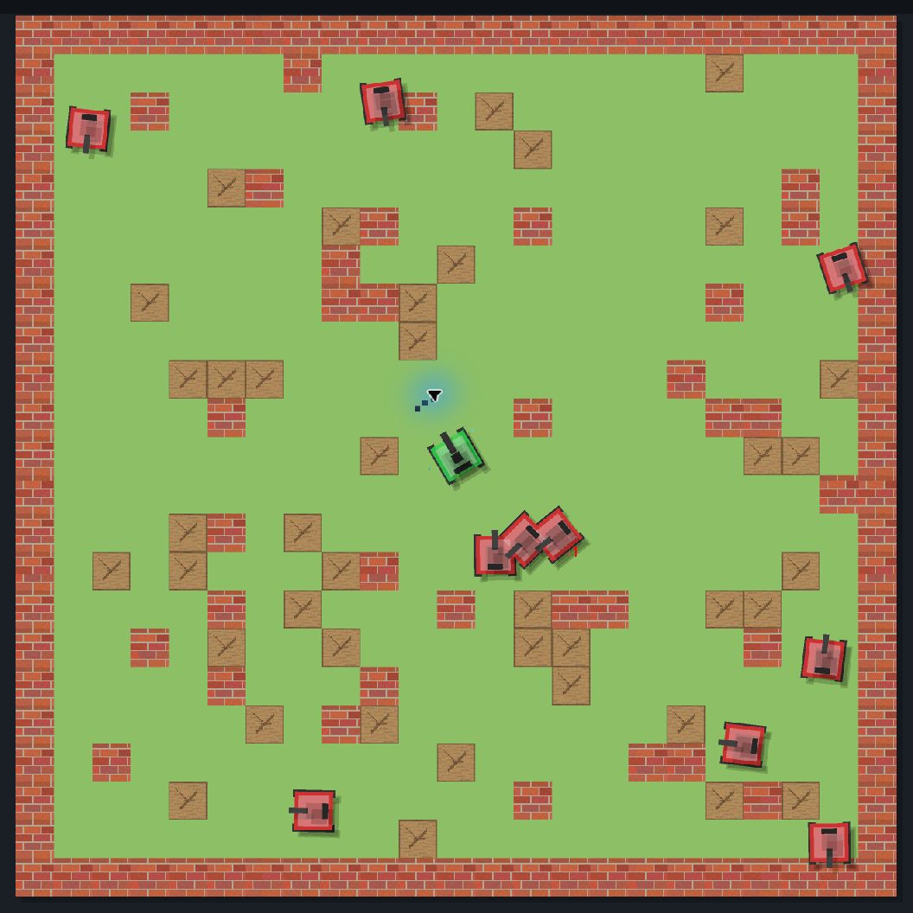
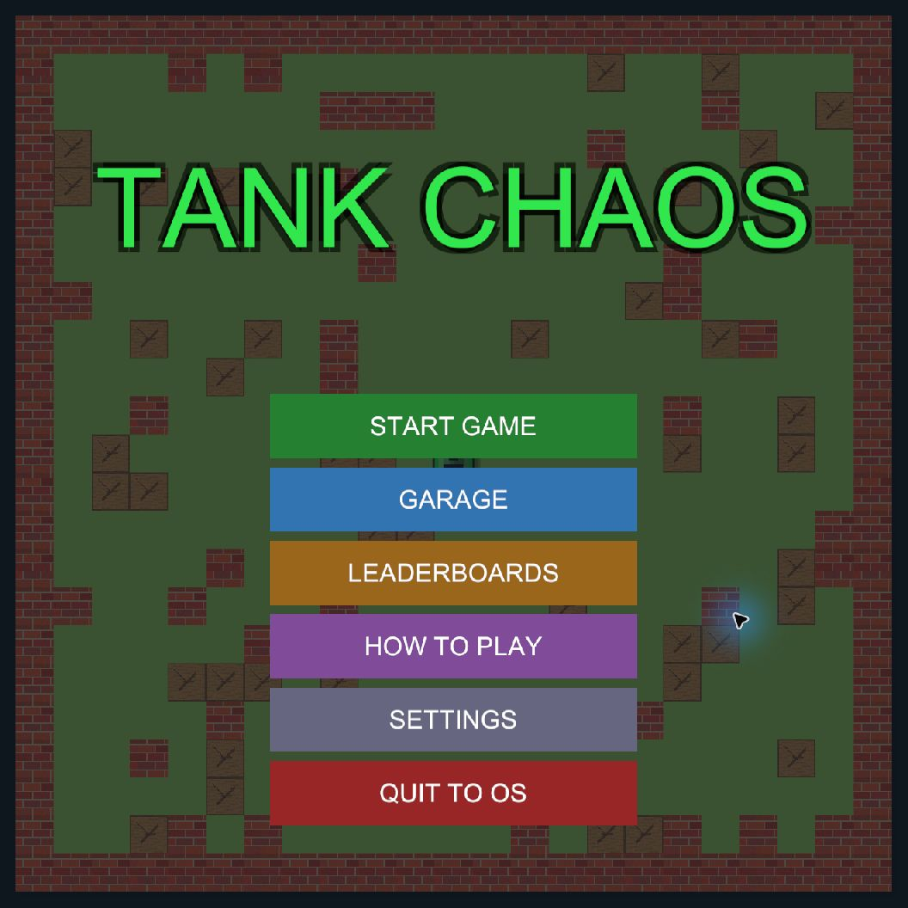
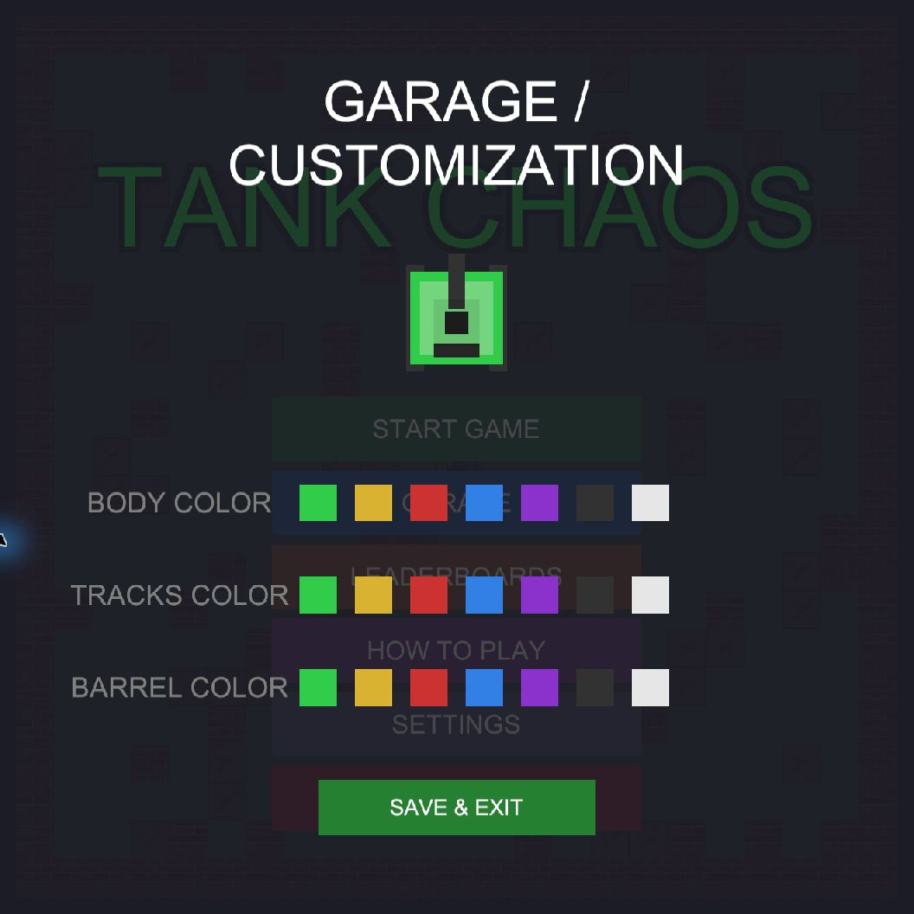
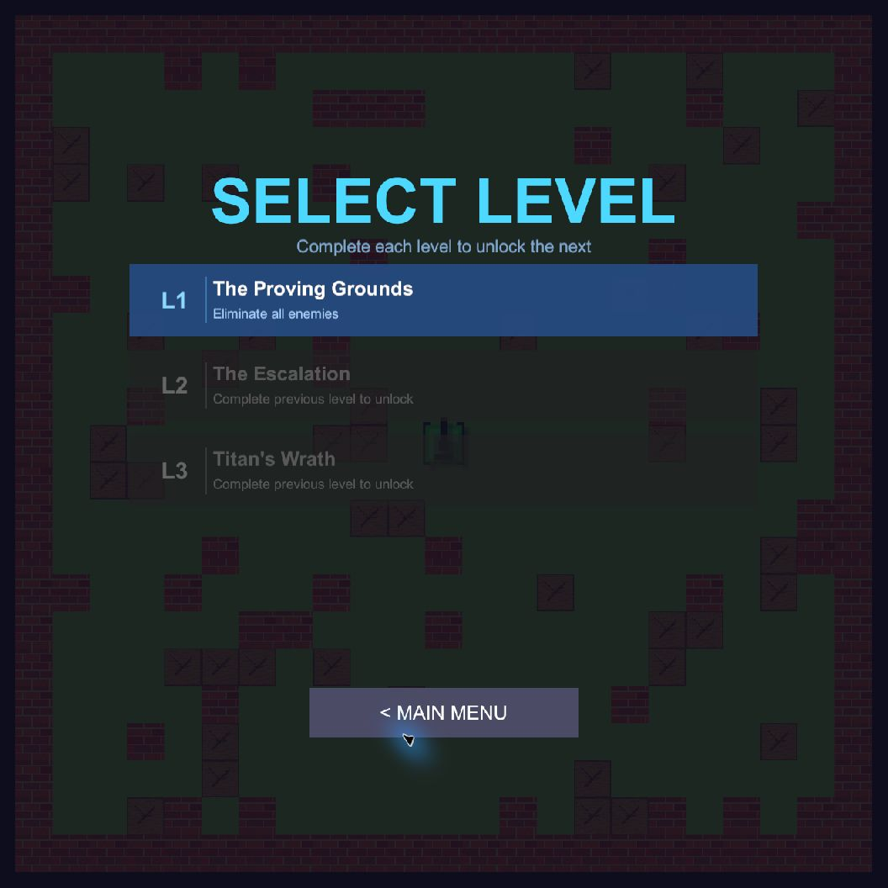

<p align="center">
  
</p>
<h1 align="center">TankChaos 2D</h1>
<p align="center"><strong>反弹炮弹，切换武器，迎战 Titan。</strong></p>
<p align="center">
  <a href="#development"></a>
  
  <a href="https://github.com/Strik1nGeorge/Tank-Chaos/releases/latest"></a>
  <a href="https://github.com/Strik1nGeorge/Tank-Chaos/releases/tag/v1.0.1"></a>
</p>
<p align="center">
  <a href="https://github.com/Strik1nGeorge/Tank-Chaos/releases/latest"><strong>下载 Windows 版</strong></a> ·
  <a href="#screenshots">实机截图</a> ·
  <a href="#controls">操作方式</a> ·
  <a href="#development">从源码运行</a>
</p>
<p align="center"><a href="README.md">English</a> | 简体中文</p>

TankChaos 2D 是一款使用 Unity 2022.3 LTS 开发的俯视角街机坦克射击游戏。
玩家需要依次挑战三个难度递增的关卡，在加农炮与霰弹枪之间切换，收集临时强化，
自定义坦克外观，并最终击败拥有三个阶段的 Boss。

<a id="screenshots"></a>

## 实机截图

| 初入试炼场 | 霰弹交火 |
|:---:|:---:|
| <a href="docs/images/gameplay.png"></a> | <a href="docs/images/combat.png"></a> |
| **主菜单** | **打造你的坦克** |
| <a href="docs/images/main-menu.png"></a> | <a href="docs/images/garage.png"></a> |

*截图来自 Windows v1.0.1 实际运行画面，点击图片可查看大图。*

## 开始游玩

1. [下载最新 Windows 版本](https://github.com/Strik1nGeorge/Tank-Chaos/releases/latest)。
2. 完整解压 ZIP 压缩包。
3. 运行 `TankChaos_2D.exe`，点击 **Start Game**，进入 **The Proving Grounds**。

请将可执行文件与配套文件夹放在一起。直接游玩无需安装 Unity，打开或构建源码时才需要。

- **三关挑战，最终决战：** 从基础敌人一路推进，挑战拥有三个战斗阶段的 Titan。
- **切换武器，改变打法：** 利用加农炮反弹、近距离霰弹，以及第三关的穿透激光。
- **每次开局都有变化：** 在随机生成的可破坏与不可破坏掩体间周旋，收集生命和伤害强化。
- **你的坦克，你的进度：** 独立搭配车身、履带和炮管颜色，保留本地解锁进度、设置与排行榜。

<details>
<summary><strong>v1.0.1 更新内容</strong></summary>

- 新增临时穿透型激光武器和第三关专属道具池。
- 加入背景音乐加载、曲目切换和新音乐。
- 重做关卡节奏、地图生成、敌人刷新与 Boss 行为。
- 改进 HUD、操作说明、菜单、设置界面和战斗反馈。
- 普通加农炮弹现在可以稳定地从不可破坏墙体上反弹。
- 补齐发布版本缺失的源码，并将项目版本统一为 1.0.1。

</details>

## 游戏玩法

玩家需要在 23 × 23 的战场中消灭当前关卡的所有敌人，在时间结束前完成目标，
收集敌人掉落的强化道具，并逐步解锁后续关卡。关卡进度、设置、坦克颜色和本地
排行榜都会在不同游戏会话之间保留。

<a id="controls"></a>

### 操作方式

| 输入 | 操作 |
|---|---|
| `W` `A` `S` `D` | 移动坦克 |
| 移动鼠标 | 瞄准炮塔 |
| 鼠标左键 | 使用当前武器开火 |
| 鼠标右键 | 切换加农炮/霰弹枪（3 秒冷却） |
| 按住 `Left Shift` | 消耗体力进行加速 |
| `Space` | 暂停或继续游戏 |

<details>
<summary><strong>展开查看武器、关卡、Boss 阶段与强化道具</strong></summary>

### 武器与子弹规则

| 武器 | 行为 |
|---|---|
| 加农炮 | 精准单发，冷却时间 1 秒。普通玩家炮弹会从不可破坏墙体上反弹。 |
| 霰弹枪 | 一次发射三枚短射程弹丸，冷却时间 0.8 秒；碰墙后消失。 |
| 激光 | 第三关可获得的 5 秒临时武器。射速更快、造成 2 点伤害、摧毁可破坏墙并穿透不可破坏墙。 |

敌方子弹碰到墙体后会消失。任何能够造成伤害的弹丸都可以摧毁可破坏墙体。

### 关卡

<p align="center"><a href="docs/images/level-select.png"></a></p>

| 关卡 | 名称 | 配置 |
|---|---|---|
| 1 | **The Proving Grounds** | 10 个基础敌人，不刷新，限时 150 秒 |
| 2 | **The Escalation** | 10 个基础敌人 + 10 个快速敌人，包含增援刷新，限时 150 秒 |
| 3 | **Titan's Wrath** | 5 个初始敌人、Titan Boss、阶段增援、较低障碍密度，不限时 |

关卡按顺序解锁。通关后，分数和完成时间会写入对应关卡的本地排行榜。

### Titan Boss

Titan 拥有 **45 HP**，生命值下降时会切换战斗阶段。

| 阶段 | 生命值 | 移动速度 | 攻击方式 |
|---|---:|---:|---|
| Hunting | 高于 66% | 1.0 | 每 2.0 秒发射一枚子弹 |
| Berserker | 34%–66% | 1.8 | 每 1.0 秒发射三连散射 |
| RAMPAGE | 33% 或更低 | 3.0 | 每 0.7 秒发射范围更大的三连散射 |

阶段切换会更新 Boss HUD、触发视觉提示，并可能召唤额外敌人。

### 强化道具

从第二关开始，地图会定期生成强化道具；敌人死亡时也有 20% 概率掉落道具。

| 颜色 | 道具 | 效果 |
|---|---|---|
| 绿色 | 生命恢复 | 恢复 1 HP，最高不超过 5 HP |
| 蓝色 | 伤害强化 | 持续 5 秒：加农炮伤害变为 ×3，强化霰弹每枚造成 2 点伤害 |
| 青色 | 激光 | 仅第三关出现，激活 5 秒穿透型激光武器 |

玩家初始拥有 **5 HP** 和 **3 条命**，受伤后会获得 1.5 秒无敌时间。

</details>

<a id="development"></a>

## 开发指南

<details>
<summary><strong>展开查看环境要求、源码运行、Windows 构建与架构说明</strong></summary>

### 主要系统

- **状态驱动的游戏流程：** `GameManager` 统一管理主菜单、关卡选择、游戏中、
  暂停、胜利和失败状态。
- **程序化地图：** 每次游戏都会生成包含不可破坏与可破坏掩体的新战场；第三关
  会降低障碍密度，为 Boss 战留出空间。
- **子弹对象池：** `BulletPool` 重复利用子弹对象，降低战斗过程中的内存分配。
- **多种敌人：** 基础坦克、快速坦克和三阶段 Boss 使用视线判断与移动逻辑。
- **车库自定义：** 可分别设置车身、履带与炮管颜色，并保存在本地。
- **本地进度：** 已解锁关卡、设置、皮肤和排行榜会在不同游戏会话间保留。
- **音频系统：** 包含关卡 BGM、胜利曲目、程序化音效，以及独立的 BGM/SFX
  音量控制。
- **界面与反馈：** 包含 HUD、Boss 血条、冷却指示、操作说明、分数浮字、
  粒子、爆炸和镜头震动。
- **编辑器工具：** 可通过 `Tools > Game Tools` 执行项目设置、预制体生成和
  UI 场景重建。

### 环境要求

- 推荐使用 Unity **2022.3.62f3 LTS**。
- 构建 Windows 版本需要安装 Windows Build Support。
- 项目使用内置渲染管线、旧版 Input Manager，以及
  `Packages/manifest.json` 中列出的 Unity 官方注册表包。
- 运行游戏不需要额外的第三方运行时依赖。

### 从源码运行

```powershell
git clone https://github.com/Strik1nGeorge/Tank-Chaos.git
cd Tank-Chaos
```

1. 在 Unity Hub 中添加克隆后的目录。
2. 使用 Unity `2022.3.62f3` 打开项目。
3. 打开 `Assets/Scenes/MainGame.unity`。
4. 等待脚本和资源导入完成。
5. 点击 Play。

`MainGame.unity` 是当前使用的游戏与构建场景。`GameScene.unity` 仍保留在仓库中，
但已在 Build Settings 中禁用。

#### 重建自动生成内容

以下编辑器工具仅应在对应场景或预制体确实需要重新生成时使用：

```text
Tools > Game Tools > Setup Game Scene
Tools > Game Tools > Build Prefabs
Tools > Game Tools > Build UI Scene
Tools > Game Tools > [REBUILD FULL PROJECT]
```

执行完整重建前，请先提交或备份场景修改。

### 构建 Windows 版本

#### 使用 Unity 编辑器

1. 打开 `File > Build Settings`。
2. 确认只有 `Assets/Scenes/MainGame.unity` 被启用。
3. 选择 `PC, Mac & Linux Standalone`。
4. 将目标平台设为 Windows，架构设为 `x86_64`。
5. 构建到一个干净目录，例如 `Builds/Windows/`。

分发游戏时，必须将可执行文件、`TankChaos_2D_Data`、`UnityPlayer.dll`、
`UnityCrashHandler64.exe` 和 `MonoBleedingEdge` 保持在同一个目录结构中。

#### 使用命令行

```powershell
& "<UnityEditorPath>\Unity.exe" `
  -batchmode -quit `
  -projectPath "<ProjectPath>" `
  -buildTarget Win64 `
  -buildWindows64Player "<OutputPath>\TankChaos_2D.exe" `
  -logFile "<OutputPath>\build.log"
```

请根据你的电脑修改项目路径与输出路径。

### 项目结构

```text
Assets/
├── Editor/                 # 场景、预制体、UI、标签与图层设置工具
├── Resources/
│   ├── Audio/BGM/          # 菜单、关卡和胜利音乐
│   ├── Prefabs/            # 玩家、敌人、Boss 和子弹预制体
│   └── Sprites/            # 运行时加载的图片资源
├── Scenes/
│   ├── MainGame.unity      # 当前游戏与构建场景
│   └── GameScene.unity     # 已禁用的旧版/备用场景
└── Scripts/
    ├── Audio/              # 音乐与音效管理
    ├── Combat/             # 子弹行为与对象池
    ├── Core/               # 游戏状态、关卡、地图生成与启动逻辑
    ├── Data/               # 存档、排行榜和坦克皮肤
    ├── Enemies/            # 敌人类型、AI、刷新和 Boss 逻辑
    ├── Map/                # 可破坏墙体
    ├── Pickups/            # 生命、伤害、激光道具及生成逻辑
    ├── Player/             # 移动、武器、体力、生命值和剩余生命
    ├── UI/                 # 菜单、HUD、设置、说明和各类面板
    └── VFX/                # 粒子、镜头震动、阴影和分数浮字
```

### 架构说明

- `GameManager` 负责高层状态机和关卡切换。
- `GameBootstrapper` 查找或创建游戏运行所需的核心系统。
- `MapGenerator` 在运行时生成战场和掩体。
- `EnemySpawner` 管理每关敌人、刷新机制和 Boss 增援。
- `UIManager` 响应游戏状态变化并显示正确的界面。
- `SaveSystem` 保存各关卡排行榜 JSON 和关卡解锁进度。
- `SkinManager` 与音频设置使用 Unity `PlayerPrefs`。

### 存档数据

在 Windows 上，Unity 通常会将该项目的持久化数据保存到：

```text
%USERPROFILE%\AppData\LocalLow\DefaultCompany\TankChaos_2D
```

排行榜文件名为 `leaderboard_v2.json`。关卡解锁、坦克颜色和音频设置通过
`PlayerPrefs` 保存。

</details>

## 参与开发

欢迎提交 Issue 和范围明确的 Pull Request。修改玩法后请至少验证：

1. 在 `MainGame.unity` 中完整测试三个关卡。
2. 确认玩家和敌方子弹行为正确。
3. 验证暂停、胜利、失败、存档和关卡解锁。
4. 不要提交 Unity 自动生成的 `Library`、`Logs`、`Temp` 或构建输出目录。

## 许可说明

本仓库用于学习与作品展示。你可以出于这些目的研究、Fork 和继续开发项目。
仓库目前未包含单独的正式许可证文件；如需商业使用或重新分发，请先联系仓库所有者。
